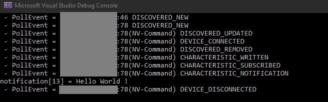

# BluetoothLowEnergyApi Dll



Simple Dynamic Linked Library (DLL) allowing to communicate with bluetooth devices. Initially created for Unity.

This project is based on [UWP BLE API](https://docs.microsoft.com/de-de/windows/uwp/devices-sensors/bluetooth-low-energy-overview).

## Features

- Continuous device advertisment scan
- Connect Bluetooth devices
- Disconnect Bluetooth devices
- Write data to characteristics
- Subscribe / read from characteristics
- Poll or Callback on event
- Detect if device is disconnected (lost)
- Check if the device is bluetooth enabled
- Error management

## How to use

The interface is done in C#, you can easily translate to any other language.

Copy [BluetoothLowEnergyApiTest/BleApi.cs](BluetoothLowEnergyApiTest/BleApi.cs) and [BluetoothLowEnergyApiTest/BluetoothLowEnergyApi.dll](BluetoothLowEnergyApiTest/BluetoothLowEnergyApi.dll), and use the BleApi class as static to interface with bluetooth devices (sample code available in [BluetoothLowEnergyApiTest/Program.cs](BluetoothLowEnergyApiTest/Program.cs)) used in [Test](#Test) section

## Code 

### Events

When polling data events we gather two variables : Who (`struct Device`) and What (`enum What`), who as the device responsible for this event and what the kind of event trigerred, you can find the list of events below:

```CS
enum What
{
    LIBRARY_ERROR,                      // the library error
    LIBRARY_NOTHING,                    // the library nothing (should never happen)
    LIBRARY_CALLBACK_SETUP,             // the library callback setup
    DISCOVERED_STARTED,                 // the discovered started
    DISCOVERED_STOPPED,                 // the discovered stopped
    DISCOVERED_NEW,                     // a device was discovered
    DISCOVERED_UPDATED,                 // a device advertisement was updated 
    DISCOVERED_LOST,                    // a device was lost (out of range or turned off)
    DISCOVERED_REMOVED,                 // a device was removed (manually or because of connection)
    DEVICE_CONNECTED,                   // the device connected
    DEVICE_DISCONNECTED,                // the device disconnected
    DEVICE_LOST,                        // the device lost connection
    CHARACTERISTIC_SCAN_NEW,            // the characteristic scan new
    CHARACTERISTIC_SCAN_OVER,           // the characteristic scan over
    CHARACTERISTIC_WRITTEN,             // the characteristic written
    CHARACTERISTIC_NOT_WRITTEN,         // the characteristic not written
    CHARACTERISTIC_READED,              // the characteristic readed
    CHARACTERISTIC_NOT_READED,          // the characteristic not readed
    CHARACTERISTIC_SUBSCRIBED,          // the characteristic subscribed
    CHARACTERISTIC_NOT_SUBSCRIBED,      // the characteristic not subscribed
    CHARACTERISTIC_UNSUBSCRIBED,        // the characteristic unsubscribed
    CHARACTERISTIC_NOT_UNSUBSCRIBED,    // the characteristic not unsubscribed
    CHARACTERISTIC_NOTIFICATION         // the characteristic notification
};
```

### Structures

```CS

struct Device
{
    public UInt64 address;
    public string name;
}

struct Characteristic
{
    public bool isService;
    public string uuid;
}

struct Data
{
    public byte[] buf;
    public short size;
}

struct Event
{
    public What what;
    public Device who;
    public Characteristic characteristic;
    public Data data;
}
```

### Interface functions

```CS   
    
static bool PollEvents(ref Event ev);
static void SetEventCallback(CallbackEvent callback);
static void RemoveEventCallback();
static bool IsBluetoothEnabled();

// Device scan functions 
static void StartDeviceScan();
static void StopDeviceScan();
static void CleanAdvertisedDevices();
static void AddAdertisementFilter(byte key, byte[] data, byte len);
static void RemoveAdertisementFilter(byte key);
static void RemoveAdertisementFilters();
static bool SetAdvertisementDeviceLostTimeout(Int32 timeout_ms);

// Connect functions   
static void ConnectDevice(UInt64 deviceAddress);
static void DisconnectDevice(UInt64 deviceAddress);
static bool IsDeviceConnected(UInt64 deviceAddress);
static void DisconnectAll();
static Int16 ConnectedCount();

// Characteristics
static void DeviceWrite(UInt64 deviceAddress, string uuid, ref Data data);
static void DeviceRead(UInt64 deviceAddress, string uuid);
static void DeviceSubscribe(UInt64 deviceAddress, string uuid);
static void DeviceUnSubscribe(UInt64 deviceAddress, string uuid);

// Library clean
void Clean();
```

## Build

There is a prebuild dll included [BluetoothLowEnergyApiTest/BluetoothLowEnergyApi.dll](BluetoothLowEnergyApiTest/BluetoothLowEnergyApi.dll).
You also build it yourself by following these steps :
- Open the solution file BluetoothLowEnergyApi.sln with VisualStudio (tested with Community 2019). You may be asked install VisualStudio components when you open the project. The needed components are C++ Desktop and UWP.
- Choose configuration "Release" and "x64" (to match your machine architecture).
- In the project explorer, right-click the project "BluetoothLowEnergyApi" and choose "Compile".
- Wait until the compilation finishes successfully.

Now you find the file BluetoothLowEnergyApi.dll in the folder x64/Release. You can copy this dll where you need it. It also automatically copy the dll in `BluetoothLowEnergyApiTest/`

## Test

The BluetoothLowEnergyTest project depends on the BluetoothLowEnergy and will be built automatically if there is any change in the dll, it allows to quickly test changes.

To test the API follow these steps :
- Open the solution file BluetoothLowEnergyApi.sln with VisualStudio. You may be asked install VisualStudio components when you open the project. The needed components are C++ Desktop and UWP.
- Set BluetoothLowEnergyApiTest as **Startup Project** (right click -> Set as Startup Project)
- Choose configuration "Release" and "x64"
- Compile and run, F5 (with debugger) or Ctrl+F5 (without debugger)
- Wait until the compilation finishes successfully and the program to run.

```CS
string devName = "NV-arm";
string UART_RX = "{6e400002-b5a3-f393-e0a9-e50e24dcca9e}";
string UART_TX = "{6e400003-b5a3-f393-e0a9-e50e24dcca9e}";
```
***Important Note*** : The Characteristics need to be surrounded with braces : `{}`

This Test program is looking for a device `devName` to write and subscribe to the characteristics `UART_TX` and `UART_RX`. When started it will tell the user if the bluetooth is ready to be used (available + enabled), start scanning the devices, connect, write and subscribe, and show de notification data string in the console. When the first notification is recieved it disconnect the device and close the program, Otherwise you can cancel with Ctrl+C (will disconnect and exit).

If the device is lost, it will automatically reconnect when available.

## Issues 

Please feel free to submit issues with any bugs or other unforseen issues you experience. If you experience problems, open an issue describing the problem and how to reproduce it, and I'll be sure to take a look at it.

## Licence

[MIT](https://choosealicense.com/licenses/mit/)

## Author 

Arrol - [arrol.fr](https://arrol.fr)